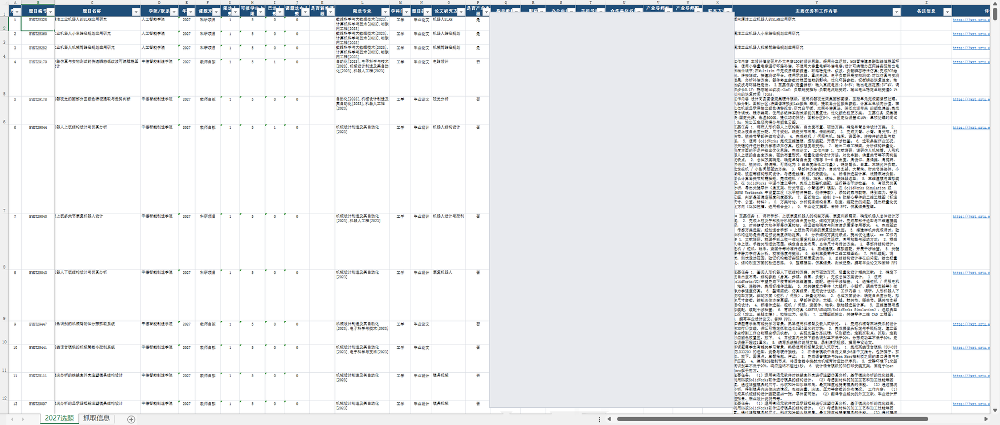

# SZTU 正方教务 · 毕业设计选题抓取助手

> 在「毕业设计 → 学生选题」页面点三下，把全部课题（列表 + 明细）导成一张 Excel。
> 为选毕设课题时不用一条条点开「课题明细」而写，现分享给需要的同学。


---

## 这是什么

一个油猴脚本（Tampermonkey userscript）。打开SZTU教务系统的学生毕业选题页，右下角出现一个小面板：

- **① 抓列表** — 自动按 `pageIndex` 翻页，约 10 秒
- **② 抓明细** — 并发 3 / 每条间隔 180ms，300+ 条约 2~3 分钟
- **③ 导出 Excel** — 内置零依赖 xlsx 生成器，输出 27 列带样式、冻结窗格、自动筛选的表格

| 来源 | 抓到的字段 |
|---|---|
| 列表页 | 年度、设计(论文)题目、院系、指导教师、职称、已选人数、课题选中人数、是否辅修课题、可报人数上限 |
| 明细页 | 题目编号、限选专业、学科门类、题目类型、论文研究方向、是否产业真题、办公电话、手机号码、合作单位名称、产业导师姓名/职称/联系方式、主要任务和工作内容、备注信息、进度安排、送审单位、详情链接 |

## 适用范围

- **系统**：正方教务（`/jsxsd/` 路径）
- **页面**：毕业设计 → 学生选题（列表帧 `bysj/xsxt.do`，明细页 `view/bysj/kt_Mx_14655.htmlx`）
- **已验证**：深圳技术大学 `jwxt.sztu.edu.cn`（2026-11，307 条实测）
- **不能跨校**：`kt_Mx_14655` 这类 form id 与菜单路径是本校这套系统的，换学校需改 `CFG`

## 安装（三种方式，任选其一）

### 方式一：点链接直接装

1. 先给浏览器装好 [Tampermonkey](https://microsoftedge.microsoft.com/addons/detail/tampermonkey/iikmkjmpaadaobahmlepeloendndfphd)（Edge）或 [Chrome 版](https://chromewebstore.google.com/detail/tampermonkey/dhdgffkkebhmkfjojejmpbldmpobfkfo)
2. 点这个链接，Tampermonkey 会自动弹出安装页，点「安装」即可：

   ```
   https://cdn.jsdelivr.net/gh/Ruanthreegold/jwxt-topic-helper@main/jwxt-topic-helper.user.js
   ```

   > 国内访问 jsDelivr 通常比 `raw.githubusercontent.com` 稳定。两个链接都放这里备用：
   > - jsDelivr：`https://cdn.jsdelivr.net/gh/Ruanthreegold/jwxt-topic-helper@main/jwxt-topic-helper.user.js`
   > - Raw：`https://raw.githubusercontent.com/Ruanthreegold/jwxt-topic-helper/main/jwxt-topic-helper.user.js`


### 方式二：把脚本文件拖进油猴（最省事）

1. 先把 `jwxt-topic-helper.user.js` 存到本地任意文件夹
2. 浏览器点 Tampermonkey 图标 → **管理面板**
3. 用鼠标把那个 `.js` 文件**直接拖进管理面板的页面里** → 弹出安装页 → 点「安装」

> 注意区分：拖到**油猴管理面板**里才装得上；如果在资源管理器里直接双击文件，
> 有些浏览器会把它当文本打开，看着像坏了。

### 方式三：手动粘贴（最稳，不受网络影响）

1. 点 Tampermonkey 图标 → **管理面板** → 左下角「**+**」新建脚本
2. 删掉编辑器里的示例代码，把 [`jwxt-topic-helper.user.js`](./jwxt-topic-helper.user.js) 全文粘贴进去
3. `Ctrl + S` 保存

## 使用

1. 打开教务系统 → 毕业设计 → **学生选题**，等列表显示出来
2. 右下角面板依次点击 **① 抓列表 → ② 抓明细 → ③ 导出 Excel**
3. 用 Excel 的筛选功能按方向 / 关键词 / 教师筛

控制台等价命令：

```js
__JWH.list()          // 抓列表
__JWH.detail()        // 抓明细
__JWH.exportXlsx()    // 导出 Excel
__JWH.exportCsv()     // 导出 CSV
__JWH.status()        // 看进度
__JWH.stop()          // 停止
```



## 安全与隐私

这个脚本会读你能看到的教务系统页面，所以把边界写清楚：

- **不绑账号**：代码里没有任何学号、姓名、token、session 之类的信息
- **不改数据**：只查询列表页和明细页，**不会**替你提交选题、不会改动任何状态
- **不外发**：全脚本只有 1 处 `fetch()`，目标是当前站点自己的 form action 与 `to_mx()` 给出的相对地址，没有任何第三方域名
- **不落地**：不读写 `localStorage` / `gitcookie` / `indexedDB`，抓到的数据只在页面内存里，点导出才写成你本地的文件
- **不加载外部代码**：没有 `@require` / `@resource` / `@connect`
- **限定站点**：`@match` 只含本校教务域名，且有 `@noframes`
- **联系方式默认隐藏**：教师手机号 / 办公电话导出时替换为「（已隐藏）」，需在面板手动勾选

不放心可以自己搜：`fetch(` 只有 1 处，`cookie`、`localStorage` 均 0 处。

## 原理（给想改的人）

1. 教务系统的壳页只是菜单，内容全在 iframe 里 → 递归找到含表格的那一帧
2. 列表是服务端渲染 HTML，分页靠隐藏域 `pageIndex` → 照抄页面自己的 `<form>`（action/method/隐藏域）再改页码
3. 每行的 `课题明细` 是 `javascript:to_mx('<tid>')` → 临时劫持 `window.open` 调一次 `to_mx()`，拿到真实明细地址模板
4. 明细页是 `div.label` + `div.content` 的表单，控件 `name` 是固定拼音 → 按 name 精确取值，中文标签仅作兜底
5. xlsx 由内置的 ZIP + SpreadsheetML 生成，不依赖任何库

字段 name 映射见脚本里的 `DETAIL_MAP`。

## 常见问题

**面板没出现？** 确认 Tampermonkey 已启用（图标不是灰的）→ 刷新页面 → 确认当前是教务系统页面。

**点「抓列表」提示"没找到选题列表"？** 说明还没进到学生选题页，先把列表点出来。

**抓到一半数字不动了？** 大概率登录超时。重新登录 → 刷新 → 重抓。

**导出的 Excel 打不开？** 改「导出 CSV」，或用 WPS/Excel 打开；仍不行请提 issue 并附浏览器版本。

**我的专业能用吗？** 能。系统按你的专业过滤列表，你看到的就是你能选的题。

**其他学校能用吗？** 不能，需要改 `CFG` 里的路径与明细模板。

## 免责

个人工具，非学校官方产物。只读取你本来就能看到的页面内容，不做任何写入操作。
请错峰使用（单人并发 3、每条 180ms），不要几十人同时运行给教务系统造成压力。
若学校改版导致失效，欢迎提 issue，但不保证修复时间。

## License

[MIT](./LICENSE)
